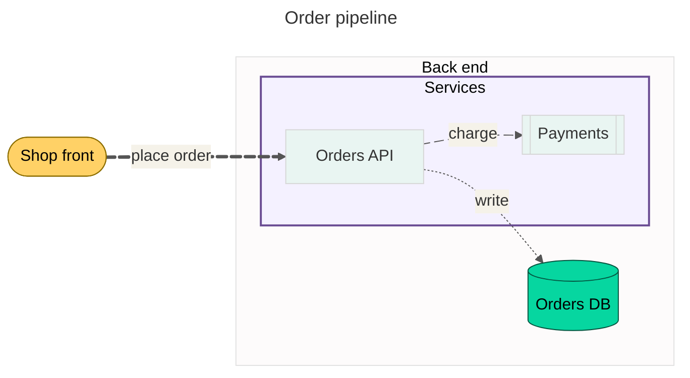

# Diagrams

Agents draw and revise diagrams through five MCP tools. A diagram is
[Mermaid](https://mermaid.js.org/) text stored in a wiki page, never an image.
Images are made from the text when someone looks at it.

Because the text is the stored thing, diagrams get the wiki's history, diff
and revert with no extra work. A change to one node label is a one-line change
in the page's History.

## The tools

| Tool | Scope | What it does |
|---|---|---|
| `diagram_create` | `wiki_write` | Saves a new diagram as `<AI folder>/diagrams/<name>.md` (or at a page path you give) and returns a PNG. Never overwrites. |
| `diagram_get` | `wiki_read` | Returns the source with line numbers and its **version**. |
| `diagram_patch` | `wiki_write` | Applies targeted edits: replace an exact snippet, or replace, insert or delete a line. Pinned with `if_version`. Returns a PNG. |
| `diagram_render` | `wiki_read` | Returns a PNG or SVG of a stored diagram, or of source that is not saved. |
| `diagram_list` | `wiki_read` | Lists the diagrams in `<AI folder>/diagrams/`. |

The full input schemas are in [reference/mcp-tools.json](reference/mcp-tools.json),
which is generated from the server's registered tools.

- **Versions.** The version is the first 12 hex digits of the SHA-256 of the
  page. `diagram_patch` refuses a version that is not current, and the editor
  checks again when it writes. When two agents change the same diagram, the
  second one is told to read it again. Its change does not overwrite the first.
- **Validation.** Mermaid's own parser checks every create and patch before
  anything is saved. If the source has an error, the tool returns the message
  and the line number, and does not save. The line number counts in the
  source you sent, including front matter, `%%{init}%%` directives and `%%`
  comments. (Mermaid removes those before it parses, so its own numbers
  can be wrong. The validator corrects them.)
- **Structured result.** `diagram_create` and `diagram_patch` return
  `structuredContent` next to the text: `saved` and `validated` (both
  booleans), plus `path` and `version` when the diagram was saved, or
  `error` (`message`, `line`) when it was not. `validated` is true only
  when Mermaid's parser checked the source.
- **Undo.** Use `wiki_history` and `wiki_revert` on the diagram's page.
- **Stable IDs.** Give nodes short, explicit IDs and put the words in a
  quoted label (`A["Log in"] --> B["Check password"]`). Then a revision can
  change one label without changing other lines, and the quotes keep
  punctuation in a label from breaking the parse.
- **Dash warning.** House style bans em and en dashes (U+2014, U+2013).
  When a created or patched source contains one, the write is still saved,
  and the result carries a warning: `warnings: [{code: "dash", lines: [...],
  message}]` in the structured content, and the same lines in the text.
- **Layout warnings.** Some flowcharts parse cleanly but lay out badly with
  the dagre layout Elefant ships (`layout-elk` is left out for license
  reasons). A created or patched flowchart is still saved, and the result
  carries one warning per kind, each with the `lines` to look at:
  - `layout-direction-ignored`: a `direction` line inside a subgraph that
    dagre ignores, because an edge crosses that subgraph's border. It also
    names the `subgraphs`. Attach crossing edges to the subgraph itself.
  - `layout-subgraph-title-br`: a `<br/>` in a subgraph title. A two line
    cluster title can overlap the first node inside it.
  - `layout-deep-nesting`: an edge that reaches a node nested more than 2
    subgraphs deep from outside its cluster. Such edges tangle and overlap
    labels. Attach the edge to the enclosing subgraph, and leave out edges
    that containment already shows.

  The tool descriptions carry the same rules, and the advice to split a
  diagram into an overview and detail diagrams past about 30 nodes.
- **Descriptions.** The four tools that take Mermaid share one block of
  guidance in their descriptions: front matter, IDs and quoted labels,
  styling, edge IDs and `animate`, `block`, `if_version`, the dash
  warning, and the layout rules. A test in `mcp/tests/test_diagrams.py` checks the key phrases,
  and checks that the Mermaid version they name is the one the images and
  the wiki ship.

## A worked example

This diagram uses most of the syntax agents reach for. It is valid on the
Mermaid that Elefant ships (11.16.0).

````markdown

````

What each part does:

| Part | Purpose |
|---|---|
| Front matter (`---` to `---`) | Comes before the diagram type. Sets the title, the theme and flowchart settings. |
| `flowchart LR` | The diagram type. It is the first line after the front matter. |
| `classDef` and `class` | Define a style once and apply it to several nodes. `api:::entry` does the same inline. |
| `style svc ...` | Styles one node or one subgraph. |
| Nested `subgraph` with `direction` | Groups nodes. Each group can lay out in its own direction. |
| `e1@==>` and `e1@{ animate: true }` | Names an edge, then animates it. Edge IDs and `animate` need a recent Mermaid. Elefant ships 11.16.0. |
| `api["Orders API"]` | A short, stable ID with the words in a quoted label. |

To change the label of the payments node later, read the diagram with
`diagram_get`, then patch only that line:

```json
{"name": "order-pipeline", "if_version": "<version from diagram_get>",
 "edits": [{"op": "replace", "old": "pay[[\"Payments\"]]", "new": "pay[[\"Payments service\"]]"}]}
```

## Validating

The `diagram-validator` service runs Mermaid's parser in plain Node. It
uses [linkedom](https://github.com/WebReflection/linkedom) as the DOM, so it
does not need a browser. It is part of the standard install, in Docker
Compose and in the Kubernetes base. It has no network access, and each
parse has a hard timeout.

| | |
|---|---|
| Image size | About 80 MB on top of `node:22-slim` (about 330 MB in total, uncompressed). linux/amd64 and linux/arm64. |
| Memory | About 70 MiB idle and 80 MiB under steady load. The Compose limit is 256 MB, so it fits on a 4 GB node. |
| Speed | About 25 ms to parse a flowchart with 100 edges. |

The tools find a validator in this order:

1. The `diagram-validator` checks every write.
2. If the validator does not answer, the optional renderer checks the write.
   The renderer also checks every write when the tool returns an image.
3. If neither answers, the write is **refused**. Nothing is saved, and the
   message tells you how to turn validation on.

To save diagrams without validation instead, set
`DIAGRAM_ALLOW_UNVALIDATED=true` on the MCP server. This is off by default.
With it set, a write that nothing could check is saved with `validated:
false` and a warning. A source that a validator rejects is still refused.

## Rendering

- **In the wiki**, the browser draws each ```` ```mermaid ```` block with a
  copy of mermaid in `memory-ui/static/mermaid.min.js`. The browser loads it
  only for pages that have a diagram. It uses `securityLevel: "strict"`.
- **Front matter `config` is honoured**, in the wiki and in the renderer.
  Strict mode refuses links, click handlers and HTML in labels, and it
  protects settings such as `securityLevel` itself. It does not block
  theming. So a diagram's `title`, `config.theme` and
  `config.themeVariables` take effect, and a diagram with `theme: base`
  keeps its own colours when the reader is in dark mode. Leave the theme
  out if the diagram should follow the reader's light or dark mode.
- **What is tested.** One invented deployment diagram,
  `diagram-validator/scripts/fixtures/rich-network.mmd`, uses the advanced
  syntax agents reach for: front matter `config` and `themeVariables`,
  `classDef` and `class`, `style` on subgraphs, nested subgraphs with
  `direction`, hexagon, cylinder, stadium and subroutine shapes, edge IDs
  with `animate`, and dotted and thick edges with labels. The validator,
  the renderer's selftest, the wiki reader test (`memory-ui`) and the MCP
  tool tests all use it. A Mermaid upgrade that breaks any of that syntax
  fails CI.
- **For agents**, the optional `diagram-renderer` service draws the image in a
  headless Chromium. It has no network access, a hard timeout per render, and
  a cache keyed by a hash of the source. It is a separate image, so the core
  images stay small.

### Fonts and image size

The wiki and the renderer draw labels in the same font. Both use the wiki's
sans stack, which starts with Inter (`--font-sans` in
`memory-ui/static/appearance.css`). The renderer image installs Inter
(`fonts-inter`, OFL-1.1), with DejaVu Sans and Liberation Sans as fallbacks.
A test keeps the renderer's stack equal to the wiki's.

A diagram can set its own font with `themeVariables.fontFamily`. Mermaid
silently drops any theme variable that has a hyphen in it, so
`fontFamily: Inter, Arial, sans-serif` is dropped because of `sans-serif`.
The labels then use the page font. In the wiki and in the renderer, that is
the same sans stack. To set a font that Mermaid keeps, leave out the
hyphenated names (for example `fontFamily: Inter, Arial`).

PNGs show the diagram at its own size (the width of its SVG `viewBox`), at
a device scale factor of 2. A 16px label is 32 pixels high in the image. A
diagram wider than 6000 CSS pixels is scaled down to that width, so the PNG
stays under Chromium's screenshot size limit.

The renderer is optional. Without it, the tools still validate, save and
patch diagrams. They return no image, and the result says how to turn the
renderer on. `diagram_render` returns `rendered: false` and still parses
the source. `diagram_create` and `diagram_patch` keep `saved` and
`validated`. In all three, `renderer` in the structured content has:

| Field | Value |
|---|---|
| `available` | `false` |
| `enable.compose` | `COMPOSE_PROFILES=diagrams` in `.env`, then `docker compose up -d` |
| `enable.kubernetes` | The `diagram-renderer` component of the base (`deploy/k8s/base/diagram-renderer.yaml`), with `DIAGRAM_RENDERER_URL` pointing at it |
| `still_works` | Parse validation, create, patch and get, and drawing in the wiki |
| `does_not_work` | Images (PNG or SVG) from the diagram tools |

| Install | Turn the renderer on |
|---|---|
| Docker Compose | Add `COMPOSE_PROFILES=diagrams` to `.env`, then `docker compose up -d`. |
| Kubernetes | The base includes it. To leave it out, see the header of `deploy/k8s/base/diagram-renderer.yaml`. |

Settings for all three are in the configuration reference: the
[MCP server](configuration.md#mcp), the
[diagram-validator](configuration.md#diagram-validator) and the
[diagram-renderer](configuration.md#diagram-renderer).
